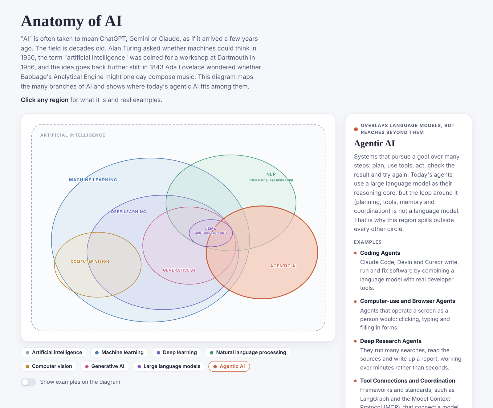

# Anatomy of AI

An interactive diagram showing that artificial intelligence is far more than chatbots. It maps the main branches of AI (machine learning, deep learning, natural language processing, computer vision, generative AI and large language models) and shows where today's agentic AI fits among them.

**[View the live page](https://liamyardley.github.io/Anatomy-of-AI/)**



## Why this exists

"AI" is often taken to mean ChatGPT, Gemini or Claude, as if it arrived a few years ago. The field is decades old. Alan Turing asked whether machines could think in 1950, the term "artificial intelligence" was coined for a workshop at Dartmouth in 1956, and the idea goes back further still, to Ada Lovelace in 1843.

This page is written for everyone, not just specialists. Technical terms are spelled out in full, and every example comes with a plain-English explanation.

## What the diagram shows

Every region sits inside artificial intelligence, but the nesting is deliberately imperfect:

- **Machine learning** sits inside AI, and **deep learning** sits inside machine learning. Much of AI (expert systems, search and planning) doesn't learn from data at all.
- **Natural language processing** and **computer vision** straddle the machine learning boundary, because both began with hand-written rules before machine learning took over.
- **Generative AI** sits inside deep learning, and **large language models** live in the small lens where generative AI meets language processing.
- **Agentic AI** overlaps large language models but reaches beyond every other circle. Today's agents use a language model as their reasoning core, but the loop around it (planning, tools, memory and coordination) is not a language model, and some agents, such as AlphaGo, use no language model at all.

## How to use it

- **Click any region** of the diagram, or one of the buttons beneath it, to see what that field is and a list of real examples.
- **Click the same region again** to return to the overview.
- **Turn on "Show examples on the diagram"** to label the diagram itself with examples.
- The page follows your device's light or dark mode setting, and every region can be reached with the keyboard (Tab, then Enter).

## The labs

The diagram is the map; the labs are where you get your hands on the ideas. Each region of the diagram will eventually link to a lab of its own. The first is built:

### Machine Learning Lab (`labs/ml/`)

Pick a dataset of red and blue points, choose a model, set its parameters, press **Train**, and watch the model learn to draw a boundary between the two colours, with the mathematics shown alongside. The idea is to play first and read the explanation second.

- **Four models, written from scratch** with no machine learning libraries: logistic regression, k-nearest neighbours, a decision tree and a random forest. The page shows each model's real internal numbers as it trains.
- **Endless datasets:** eight kinds, each randomised, plus your own hand-placed points. Every dataset comes from a **seed** (a number that fixes the randomness), so a whole class can type in the same seed and see exactly the same points.
- **Training you can watch:** Train, Pause, Step and Skip, at three speeds. Nothing retrains until you ask it to.
- **A worked example for any point:** hover over or tap the plot and the page shows the full calculation the model makes for that spot.
- **Honest scoring:** 30% of the points are held back as test points the model never sees. Results include accuracy, precision, recall, specificity, F1, a confusion matrix (a count of each kind of right and wrong answer) and an ROC curve (a picture of every possible decision threshold at once).
- **Compare the models** side by side, and try the predict, observe, explain activity that comes with each dataset.

To reach it from the home page, select the Machine learning region and follow the "Try it" link.

## Running it locally

There is nothing to install or build.

**The home page** still works by double-clicking: download the project folder and open `index.html` in any modern web browser. Keep the `assets` folder beside it, as it holds the page's colours.

**The labs** have to be opened through a local web server, because browsers will not load their scripts (ES modules) straight from a folder. With Python installed, open a terminal in the project folder and run:

```bash
python -m http.server
```

Then visit `http://localhost:8000/` for the home page or `http://localhost:8000/labs/ml/` for the Machine Learning Lab. Any other static web server works just as well, and so does GitHub Pages.

Fonts load from Google Fonts, and the lab's formulas are drawn by KaTeX, also loaded from the web. Without a connection the pages fall back to your system fonts and the formulas appear as plain text.

A dataset can be chosen from the address bar, for example `labs/ml/?data=moons&seed=42`.

### Tests

The models, datasets and scoring have unit tests that need only Node.js (version 20 or later), with nothing to install:

```bash
node --test
```

## Files

| File | Purpose |
| --- | --- |
| `index.html` | The home page: the interactive diagram, with its styling and scripts |
| `assets/css/theme.css` | Colours shared by the home page and the labs, for light and dark mode |
| `assets/js/optimisers.js` | Gradient descent, momentum, RMSProp and Adam: the rules for turning a gradient into a step |
| `labs/ml/index.html` | The Machine Learning Lab page |
| `assets/css/lab.css` | Layout and styling shared by the labs |
| `labs/ml/content/notes.js` | All the lab's explanatory text, kept in one place so it is easy to edit |
| `labs/ml/js/main.js` | Wiring: page state, controls and the training loop |
| `labs/ml/js/registry.js` | The list of models; adding a model starts here |
| `assets/js/rng.js` | The seeded random number generator behind everything random |
| `labs/ml/js/datasets.js` | The dataset generators |
| `labs/ml/js/plot.js` | The plot: points, shaded regions, boundary line, mouse, touch and keyboard |
| `assets/js/engine.js` | Runs any model's training step by step so it can be animated |
| `labs/ml/js/metrics.js` | Train/test split, confusion matrix, accuracy and the other scores, ROC curve |
| `labs/ml/js/compare.js` | Trains every model on the same data for the comparison table |
| `labs/ml/js/charts.js`, `assets/js/format.js` | Small helpers for charts, numbers and formulas |
| `labs/ml/js/models/` | The four models: `logistic.js`, `knn.js`, `tree.js`, `forest.js`. Plain code with no page access, so they can be tested on their own |
| `labs/ml/js/panels/` | Each model's part of the mathematics panel |
| `labs/training/` | A second lab, under construction: how a model finds its numbers |
| `plan.md` | The plan for the whole project, with what is built and what is next |
| `tests/` | Unit tests, run with `node --test` |
| `package.json` | Tells Node.js how to read the scripts; there are no dependencies |
| `preview.png` | The screenshot shown in this README |
| `README.md` | This file |

## Feedback

Spotted something inaccurate, or think a field or example is missing? Please [open an issue](../../issues) and I'll take a look.
