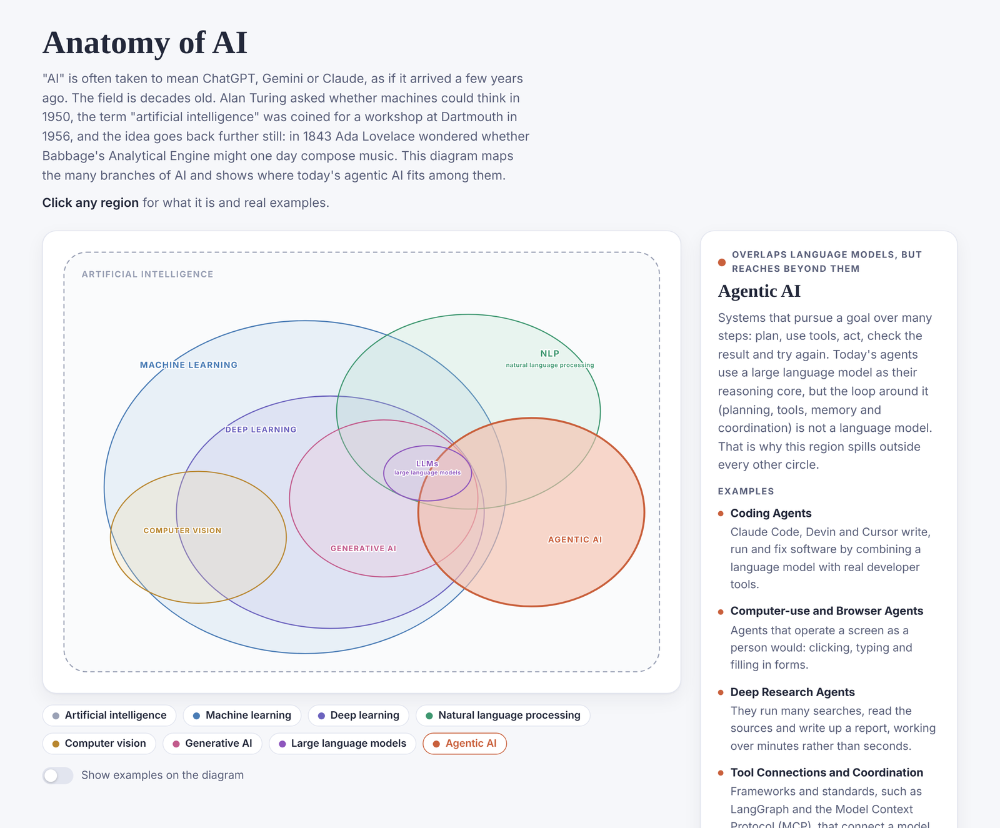

# Anatomy of AI

An interactive diagram showing that artificial intelligence is far more than chatbots. It maps the main branches of AI (machine learning, deep learning, natural language processing, computer vision, generative AI and large language models) and shows where today's agentic AI fits among them.

**[View the live page](https://liamyardley.github.io/Anatomy-of-AI/)**

## Why this exists

"AI" is often taken to mean ChatGPT, Gemini or Claude, as if it arrived a few years ago. The field is decades old. Alan Turing asked whether machines could think in 1950, the term "artificial intelligence" was coined for a workshop at Dartmouth in 1956, and the idea goes back further still, to Ada Lovelace in 1843.

This page is written for everyone, not just specialists. Technical terms are spelled out in full, and every example comes with a plain-English explanation.

## What the diagram shows

Every region sits inside artificial intelligence, but the nesting is deliberately imperfect:

- **Machine learning** sits inside AI, and **deep learning** sits inside machine learning. Much of AI (expert systems, search and planning) doesn't learn from data at all.
- **Natural language processing** and **computer vision** straddle the machine learning boundary, because both began with hand-written rules before machine learning took over.
- **Generative AI** sits inside deep learning, and **large language models** live in the small lens where generative AI meets language processing.
- **Agentic AI** overlaps large language models but reaches beyond every other circle. Today's agents use a language model as their reasoning core, but the loop around it (planning, tools, memory and coordination) is not a language model, and some agents, such as AlphaGo, use no language model at all.

## How to use it

- **Click any region** of the diagram, or one of the buttons beneath it, to see what that field is and a list of real examples.
- **Click the same region again** to return to the overview.
- **Turn on "Show examples on the diagram"** to label the diagram itself with examples.
- The page follows your device's light or dark mode setting, and every region can be reached with the keyboard (Tab, then Enter).

## Running it locally

There is nothing to install or build. The whole page is a single HTML file, so you can download it and open it in any modern web browser. Fonts load from Google Fonts when you are online; without a connection the page falls back to your system fonts.

## Files

| File | Purpose |
| --- | --- |
| `index.html` | The interactive page (all styling and scripts are included in this one file) |
| `preview.png` | The screenshot shown in this README |
| `README.md` | This file |

## Feedback

Spotted something inaccurate, or think a field or example is missing? Please [open an issue](../../issues) and I'll take a look.
